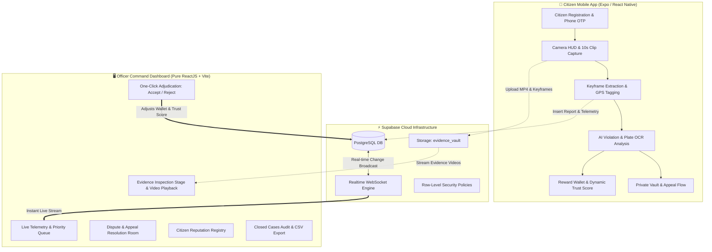

# 🚦 RoadWatch — Civic Traffic Enforcement & Evidence Verification Ecosystem

[-61DAFB?logo=react&logoColor=black)](https://react.dev/)
[](https://expo.dev/)
[](https://tailwindcss.com/)
[](https://supabase.com/)
[](https://vitejs.dev/)
[](LICENSE)

**RoadWatch** is a production-grade, end-to-end civic traffic violation reporting and police enforcement audit platform. It bridges citizens on the road with municipal traffic authorities through a high-trust verification pipeline featuring **cryptographic evidence capture**, **AI-assisted violation and license plate analysis**, **real-time Supabase cloud synchronization**, and a dedicated **Officer Command Audit Dashboard**.

---

## 📑 Table of Contents

- [System Architecture](#-system-architecture)
- [Key Features](#-key-features)
  - [1. Citizen Mobile App (`app/`)](#1-citizen-mobile-app-app)
  - [2. Officer Command Dashboard (`dashboard/`)](#2-officer-command-dashboard-dashboard)
  - [3. Supabase Cloud Backend (`server/`)](#3-supabase-cloud-backend-server)
- [Project Directory Structure](#-project-directory-structure)
- [Prerequisites & Requirements](#-prerequisites--requirements)
- [Environment Setup (`.env`)](#-environment-setup-env)
- [Installation & Quick Start](#-installation--quick-start)
  - [Root Orchestration](#root-orchestration)
  - [Running the Mobile App](#running-the-mobile-app)
  - [Running the Officer Dashboard](#running-the-officer-dashboard)
  - [Applying Supabase Database Migrations](#applying-supabase-database-migrations)
- [End-to-End Workflow & Data Pipeline](#-end-to-end-workflow--data-pipeline)
- [Database Schema & Security (RLS)](#-database-schema--security-rls)
- [Privacy & Compliance](#-privacy--compliance)
- [Troubleshooting & FAQs](#-troubleshooting--faqs)
- [Contributing & License](#-contributing--license)

---

## 🏛 System Architecture



---

## 🌟 Key Features

### 1. Citizen Mobile App (`app/`)
*Built with Expo 57, React Native 0.86, React 19, TypeScript, and Lucide Icons.*

- **🔐 Phone OTP & CNIC Hashed Onboarding:**
  - Authenticates users with Supabase Phone OTP.
  - Generates privacy-preserving SHA-256 digests of Pakistani CNICs (only the last 4 digits are stored for verification).
- **📹 Native Live Capture HUD:**
  - Real-time 10-second capture limiter with progress ring and 50MB file size safeguard.
  - Live HUD displaying capture timestamp, orientation sensors, and GPS coordinates.
  - Automatic extraction of multi-angle keyframes (`frame_1.jpg`, `frame_2.jpg`, `frame_3.jpg`).
- **🤖 Vision AI Analysis:**
  - Real-time vehicle detection, violation classification (Red Light, Illegal Parking, Wrong Way, Helmet Violation, etc.), and license plate extraction.
- **🗄️ Private Evidence Vault:**
  - Two-tier telemetry view: **Sealed Reports** (confirmed submissions awaiting officer audit) and **Pending Uploads**.
- **💰 Citizen Reward Wallet:**
  - Tracks accrued civic reward bounties (PKR) for accepted traffic violations.
  - Real-time transaction ledger and pending clearance milestones.
- **⚖️ Dispute & Appeal Flow:**
  - Fair contest mechanism allowing citizens to submit PKR 100 appeal bonds with written context for secondary human officer review.
- **🛡️ Dynamic Trust Score System:**
  - Live reputation engine: rewards verified submissions (+2 pts) and penalizes fraudulent reports (-15 pts).
- **🚨 Emergency Safety SOS:**
  - Rapid one-tap emergency dialing for Rescue 1122 and Police 15 with confirm guards.

---

### 2. Officer Command Dashboard (`dashboard/`)
*Built with pure ReactJS (100% JSX/JS), Tailwind CSS 3.4, and Vite 6. Strictly zero TypeScript or React Native web bridges for maximum web performance and maintainability.*

- **⚡ Real-Time Live Sync:**
  - Connected directly to Supabase PostgreSQL via WebSocket channel subscriptions. New citizen reports and appeals appear immediately without page refreshes.
- **📥 Pending Verification Queue:**
  - High-velocity triage list with severity-based priority tags (CRITICAL, HIGH, MEDIUM, LOW), SLA countdown timers, and quick filtering.
- **🎬 Integrated Evidence Stage:**
  - In-browser MP4 video playback streamed directly from Supabase `evidence_vault`.
  - Multi-frame keyframe carousel, mapped GPS coordinates, vehicle plate inspection, and citizen reporter notes.
- **⚖️ One-Click Adjudication Engine:**
  - **Accept Citation**: Approves the fine, credits the citizen's wallet, and increments their Trust Score.
  - **Reject Citation**: Dismisses the citation with reason tagging and deducts trust points.
- **📑 Disputed Cases & Appeals Room:**
  - Dedicated tab displaying contested citations where citizens filed appeal deposits.
- **📊 Historical Audit & CSV Export:**
  - Comprehensive searchable archive of resolved cases with date-range filters, plate lookups, and one-click CSV report exports.
- **👥 Citizen Reporter Registry:**
  - Officer directory of registered reporters, aggregate accuracy rates, trust standing, and active/suspended flags.
- **⌨️ High-Speed Keyboard Shortcuts:**
  - Press `A` to Accept, `R` to Reject, `Space` to Play/Pause video, `J`/`K` to navigate queue.

---

### 3. Supabase Cloud Backend (`server/`)
*PostgreSQL schema, database triggers, storage buckets, and RLS policies.*

- **Tables:**
  - `public.base_users`: System user identities, roles, and hashed credentials.
  - `public.reporter_profiles`: Citizen metrics, trust scores, total submissions, and status.
  - `public.reports`: Central traffic violation records, GPS data, vehicle metadata, violation types, and appeal notes.
  - `public.evidence`: Media metadata linking videos and frames to `evidence_vault`.
  - `public.reward_wallets` & `public.reward_transactions`: Ledger for citizen payout balances.
  - `public.fines`: Official citation records issued post-officer approval.
- **Storage Buckets:**
  - `evidence_vault`: Private, signed-access storage bucket supporting `video/mp4`, `video/quicktime`, and `image/jpeg`.

---

## 📁 Project Directory Structure

```text
roadwatch_original/
├── package.json                   # Root package script runner
├── README.md                      # Complete system documentation
├── .env                           # Environment configuration
│
├── app/                           # 📱 Citizen Mobile App (Expo / React Native)
│   ├── App.tsx                    # Mobile root navigation & screen routing
│   ├── package.json               # Expo & React Native dependencies
│   ├── app.json                   # Expo application manifest
│   ├── tailwind.config.js         # Mobile Tailwind configuration
│   └── src/
│       ├── components/            # UI, Mobile sheets, BottomNav, HUD overlays
│       ├── contexts/              # User, Theme, Toast, and Language contexts
│       ├── lib/
│       │   ├── supabase.ts        # Supabase mobile client setup
│       │   ├── report.ts          # Evidence packaging & upload pipeline
│       │   ├── aiAnalysis.ts      # Vision AI detection client
│       │   └── wallet.ts          # Civic reward wallet calculations
│       └── pages/mobile/
│           ├── Onboarding.tsx     # 3-Card Phone OTP + CNIC setup
│           ├── LiveCapture.tsx    # 10-second camera capture HUD
│           ├── ReportReview.tsx   # Video review, AI verdict & submission
│           ├── ReportOutcome.tsx  # Outcome inspection & dispute appeals
│           ├── Vault.tsx          # Sealed evidence & telemetry records
│           ├── Wallet.tsx         # Reward balance & payout history
│           ├── SafetyLive.tsx     # Emergency SOS 1122 / 15 HUD
│           └── Settings.tsx       # Dynamic trust score & profile
│
├── dashboard/                     # 🖥️ Officer Command Dashboard (Pure ReactJS)
│   ├── index.html                 # Web portal entry point
│   ├── package.json               # React 19, Vite 6, Tailwind CSS
│   ├── vite.config.js             # Vite development & build setup
│   ├── tailwind.config.js         # Officer portal dark-mode design system
│   └── src/
│       ├── main.jsx               # React entry point
│       ├── App.jsx                # Command portal core state & routing
│       ├── index.css              # Custom scrollbars, radar pulses & styles
│       ├── lib/
│       │   └── supabase.js        # Supabase JS web client & real-time sync
│       └── components/
│           ├── CommandSidebar.jsx # Navigation & telemetry badges
│           ├── PortalHeader.jsx   # Live connection indicator & officer badge
│           ├── PendingQueueWorkspace.jsx # Review queue & evidence stage
│           ├── CaseListWorkspace.jsx     # Closed cases audit & CSV export
│           ├── ReporterRegistryWorkspace.jsx # Citizen trust directory
│           └── ui/                # Status badges and counters
│
└── server/                        # ⚡ Supabase Migrations & Edge Functions
    └── supabase/
        ├── functions/             # Secure serverless Edge Functions
        └── migrations/            # Version-controlled SQL migration scripts
            ├── 20261005124859_connect_mobile_capture.sql
            ├── 20261005131236_restrict_active_reporters.sql
            ├── 20261006023054_verify_phone_and_complete_reporter_registration.sql
            ├── 20261006045348_update_verified_reporter_profile.sql
            ├── 20261008160000_smooth_testing_schema_and_triggers.sql
            ├── 20261012122000_fix_reward_wallets_rls_update.sql
            └── 20261016140000_enable_dashboard_access_and_evidence_storage.sql
```

---

## ⚙️ Prerequisites & Requirements

Ensure you have the following installed on your machine:
- **Node.js**: `v20.x` or `v22.x` (LTS recommended)
- **Package Manager**: `npm` (comes with Node)
- **Expo CLI**: `npm install -g expo-cli` (optional, `npx expo` works out of the box)
- **Mobile Device or Simulator**:
  - **iOS**: iPhone running **Expo Go** or Xcode iOS Simulator
  - **Android**: Android phone with **Expo Go** or Android Studio Emulator
- **Modern Web Browser**: Google Chrome, Brave, Safari, or Microsoft Edge

---

## 🔑 Environment Setup (`.env`)

Configure your environment variables in the root directory (or in `app/.env` and `dashboard/.env`).

### `app/.env` (Mobile Citizen App)
```ini
EXPO_PUBLIC_SUPABASE_URL=https://your-project.supabase.co
EXPO_PUBLIC_SUPABASE_PUBLISHABLE_KEY=your-supabase-anon-key
EXPO_PUBLIC_OPENROUTER_API_KEY=your-openrouter-key  # Optional: for live vision AI
EXPO_PUBLIC_AI_MODEL=google/gemini-2.0-flash-exp:free
```

### `dashboard/.env` (Officer Command Dashboard)
```ini
VITE_SUPABASE_URL=https://your-project.supabase.co
VITE_SUPABASE_ANON_KEY=your-supabase-anon-key
```

> [!NOTE]
> Ensure that `VITE_` and `EXPO_PUBLIC_` prefixes match the appropriate clients so that bundlers can expose variables securely to client applications.

---

## 🚀 Installation & Quick Start

### Root Orchestration
Clone the repository and install root dependencies:
```bash
git clone https://github.com/mabdula2004/roadwatch_original.git
cd roadwatch_original
npm install
```

---

### Running the Mobile App
To run the citizen mobile application with Expo:

```bash
# Start the Expo development server
npm run app

# Or run directly targeting iOS / Android
npm run app:ios
npm run app:android
```

1. Open **Expo Go** on your physical smartphone.
2. Scan the QR code displayed in your terminal.
3. If running over different Wi-Fi networks, run `npx expo start --tunnel` inside the `app/` directory.

---

### Running the Officer Dashboard
To run the pure ReactJS Officer Command Audit Portal:

```bash
# Start the Vite development server (runs on http://localhost:5173/)
npm run dashboard
```

Open your browser and navigate to:
```text
http://localhost:5173/
```

To build the dashboard for production deployment:
```bash
npm run build:dashboard
```
The optimized production bundle will be generated in `dashboard/dist/`.

---

### Applying Supabase Database Migrations

To apply database tables, security policies, and storage configurations to your Supabase project:

1. Open your [Supabase Dashboard](https://supabase.com/dashboard).
2. Go to the **SQL Editor**.
3. Execute the SQL scripts located in `server/supabase/migrations/` sequentially, especially:
   - `20261008160000_smooth_testing_schema_and_triggers.sql`
   - `20261016140000_enable_dashboard_access_and_evidence_storage.sql`
4. **Auth Settings:**
   - Go to **Authentication -> Providers -> Email**.
   - For fast local testing, ensure **Confirm email** is toggled off so user accounts authenticate immediately.

---

## 🔄 End-to-End Workflow & Data Pipeline

```text
[ Citizen App ]                     [ Supabase Cloud ]                 [ Officer Dashboard ]
      │                                     │                                    │
      ├──── 1. Record 10s Video ───────────►│                                    │
      │     (Extracts 3 Keyframes)          │                                    │
      │                                     │                                    │
      ├──── 2. Upload Evidence ────────────►│ (evidence_vault)                   │
      │     (clientCaptureId UUID)          │                                    │
      │                                     │                                    │
      ├──── 3. Insert Report ──────────────►│ (public.reports)                   │
      │     (status: pending_review)        ├────── Realtime Broadcast ─────────►│
      │                                     │       (postgres_changes)           ├─ 4. Case appears
      │                                     │                                    │    instantly on live
      │                                     │                                    │    queue
      │                                     │                                    │
      │                                     │◄───── 5. Officer Decision ─────────┤
      │                                     │       (Accept / Reject citation)   │
      │                                     │                                    │
      │◄─── 6. Trust Score Updated ─────────┤ (Dynamic trigger updates           │
      │     Wallet PKR Credited             │  reporter_profiles & wallets)      │
```

---

## 🔒 Database Schema & Security (RLS)

RoadWatch implements strict PostgreSQL Row-Level Security (RLS):

| Table | Citizen Access | Officer / Auditor Access | Security Rules |
| :--- | :--- | :--- | :--- |
| `base_users` | Read / Update Own | Read All | Phone and CNIC digest protected. |
| `reporter_profiles`| Read Own | Read All | Trust scores dynamically updated by system triggers. |
| `reports` | Insert, Read Own | Read All, Update Status | Only reporters can upload; only officers can adjudicate. |
| `evidence` | Insert Own | Read All | Stores S3 bucket keys and keyframe links. |
| `reward_wallets` | Read Own | Read All | Balances strictly updated via authenticated transactions. |
| `evidence_vault` | Upload to own path | Read All Evidence | Enforces authenticated signed media URLs. |

---

## 🛡 Privacy & Compliance

- **No Plaintext CNIC Storage**: National Identity Card numbers are never stored in plaintext. They are hashed using SHA-256 with an HMAC salt; only the last four digits are preserved for citizen profile reference.
- **Location Fencing**: GPS coordinates are collected strictly during the active 10-second camera capture window and never tracked continuously in the background.
- **Evidence Integrity**: All captured videos and keyframes are tagged with RFC4122 v4 UUID identifiers to prevent collision and evidence tampering.

---

## ❓ Troubleshooting & FAQs

#### 1. Why is the Officer Dashboard not showing new reports?
- Verify that migration `20261016140000_enable_dashboard_access_and_evidence_storage.sql` has been executed in your Supabase SQL Editor.
- Ensure that `VITE_SUPABASE_URL` and `VITE_SUPABASE_ANON_KEY` in `dashboard/.env` match your active Supabase project.

#### 2. Why does the video upload fail on mobile?
- Check your Supabase Storage bucket settings. The `evidence_vault` bucket must allow `video/mp4`, `video/quicktime`, and `image/jpeg`.

#### 3. Why does the dashboard build report TypeScript errors?
- The dashboard is built in **pure ReactJS (`.jsx` / `.js`)**. Ensure you run `npm run build` inside `dashboard/` or `npm run build:dashboard` from the root.

---

## 📄 Contributing & License

Contributions are welcome! Please create a feature branch before opening a Pull Request:
```bash
git checkout -b feature/amazing-feature
git commit -m "Add amazing feature"
git push origin feature/amazing-feature
```

Distributed under the **MIT License**. See `LICENSE` for more information.

---

**RoadWatch Ecosystem** — *Empowering safer roads through civic collaboration and transparent enforcement.*
