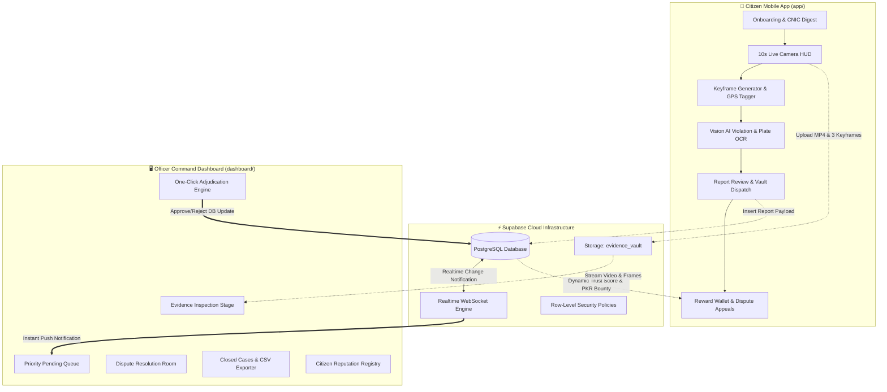

# 🚦 RoadWatch — Civic Traffic Enforcement & Evidence Verification Ecosystem

[-61DAFB?logo=react&logoColor=black)](https://react.dev/)
[](https://expo.dev/)
[](https://tailwindcss.com/)
[](https://supabase.com/)
[](https://vitejs.dev/)
[](LICENSE)

**RoadWatch** is a production-grade, end-to-end civic traffic violation reporting and police enforcement audit platform. It bridges citizens on the road with municipal traffic authorities through a high-trust verification pipeline featuring **cryptographic evidence capture**, **AI-assisted violation and license plate analysis**, **real-time Supabase cloud synchronization**, and a dedicated **Officer Command Audit Dashboard**.

---

## 📑 Table of Contents

- [👥 User Roles & Ecosystem Personas](#-user-roles--ecosystem-personas)
- [📊 Role-Based Feature & Access Matrix](#-role-based-feature--access-matrix)
- [🏛 System Architecture](#-system-architecture)
- [🔍 Comprehensive Functionality Breakdown](#-comprehensive-functionality-breakdown)
  - [1. Citizen Mobile App (`app/`)](#1-citizen-mobile-app-app)
  - [2. Officer Command Dashboard (`dashboard/`)](#2-officer-command-dashboard-dashboard)
  - [3. Supabase Cloud Backend (`server/`)](#3-supabase-cloud-backend-server)
- [🔄 Lifecycle of a Violation Report](#-lifecycle-of-a-violation-report)
- [📁 Project Directory Structure](#-project-directory-structure)
- [⚙️ Prerequisites & Environment Setup (`.env`)](#️-prerequisites--environment-setup-env)
- [🚀 Installation & Quick Start](#-installation--quick-start)
  - [Root Orchestration](#root-orchestration)
  - [Running the Citizen Mobile App](#running-the-citizen-mobile-app)
  - [Running the Officer Dashboard](#running-the-officer-dashboard)
  - [Applying Supabase Database Migrations](#applying-supabase-database-migrations)
- [🔒 Database Schema & Security (RLS)](#-database-schema--security-rls)
- [🛡 Privacy, Integrity & Legal Compliance](#-privacy-integrity--legal-compliance)
- [❓ Frequently Asked Questions (FAQ)](#-frequently-asked-questions-faq)
- [📄 Contributing & License](#-contributing--license)

---

## 👥 User Roles & Ecosystem Personas

To prevent ambiguity, RoadWatch defines **three distinct operational roles** in the ecosystem, supported by an autonomous backend engine:

```mermaid
graph LR
    subgraph Citizens["📱 Citizens / Reporters"]
        C1[Citizen On Road]
    end

    subgraph SystemAI["⚡ Core Engine"]
        S1[Vision AI & Storage]
        S2[Realtime Database]
    end

    subgraph LawEnforcement["🖥️ Law Enforcement"]
        O1[Traffic Police Officer<br>(Unified Command & Audit Desk)]
    end

    subgraph Offenders["🚗 Traffic Offenders"]
        V1[Vehicle Driver]
    end

    C1 -->|Captures 10s Clip| S1
    S1 -->|Validates & Dispatches| S2
    S2 -->|Live Stream| O1
    O1 -->|Accepts Citation| V1
    O1 -->|Credits Reward Bounty| C1
    O1 -->|Penalizes Fake Claims| C1
    O1 -->|Audits History & Appeals| S2
```

### 1. 📱 Citizen Reporter (`reporter`)
- **Who they are:** Any everyday citizen, driver, pedestrian, or commuter registered on the mobile application.
- **Primary Objectives:** Safely record dangerous traffic violations, submit genuine video evidence, track citation status, earn civic bounties, and maintain a high personal Trust Score.
- **Capabilities & Actions:**
  - Authenticate using Pakistani Phone OTP and register with a privacy-preserving SHA-256 CNIC digest (only last 4 digits stored).
  - Launch Native Live Capture HUD with live orientation sensors, GPS telemetry, and a mandatory 10-second capture limiter.
  - Review AI-detected violation classification and detected license plate before submission.
  - Inspect personal submissions inside the **Evidence Vault** (Sealed vs. Pending Review).
  - Accumulate reward bounties in the **Civic Wallet (PKR)** for verified violations.
  - File **Dispute Appeals** (with a PKR 100 refundable bond) if a valid submission is rejected.
  - Access one-tap Emergency SOS (Rescue 1122 / Police 15) during road incidents.

---

### 2. 👮 Traffic Police Officer (`officer`)
- **Who they are:** Certified municipal traffic enforcement personnel operating the unified Command Web Portal (`dashboard/`).
- **Primary Objectives:** Rapidly verify incoming citizen reports, adjudicate citations with human-in-the-loop accountability, resolve citizen appeals, audit historical closed cases, and monitor citizen trust reputation.
- **Capabilities & Actions:**
  - Access the live, zero-latency **Pending Verification Queue** via WebSocket updates without refreshing.
  - Use the full-featured **Evidence Stage** to inspect:
    - High-definition in-browser MP4 video playback streamed directly from Supabase `evidence_vault`.
    - Extracted multi-angle keyframes (`frame_1.jpg`, `frame_2.jpg`, `frame_3.jpg`).
    - Verified capture GPS coordinates, date/time stamps, vehicle plate numbers, and reporter notes.
  - **One-Click Adjudication:**
    - **Accept Citation (`A` key):** Issues an official e-challan, adds PKR bounty to the citizen's wallet, and increments their Trust Score (+2).
    - **Reject Citation (`R` key):** Dismisses report with reason tagging (Blurry, Inconclusive, No Violation, Duplicate) and penalizes citizen Trust Score (-15) if fraudulent.
  - **Dispute Appeal Hearing:** Adjudicates contested citizen appeals with deposited PKR 100 bonds under the **Disputed Cases** tab.
  - **Closed Cases Audit & CSV Export:** Search historical records by citation ID, license plate, or date range, and export official CSV audit logs.
  - **Citizen Reporter Registry:** Monitors contributors, total reports submitted, accuracy percentages, and trust scores (0 to 100).
  - Fast keyboard shortcuts (`A` Accept, `R` Reject, `Space` Play/Pause, `J`/`K` Navigate Queue).

---

### 3. 🚗 Vehicle Offender / Violator (`offender`)
- **Who they are:** The driver or vehicle owner who committed the traffic offense on public roads.
- **Role in System:**
  - Subject of the citation issued post-human officer approval.
  - **Guaranteed Human Review:** RoadWatch enforces a strict policy that **no automated fine is issued solely by AI**. An authorized human traffic officer must inspect the video evidence and confirm the violation before an official citation is finalized.

---

## 📊 Role-Based Feature & Access Matrix

| Feature / Capability | Citizen (`reporter`) | Traffic Officer (`officer`) |
| :--- | :---: | :---: |
| **Phone OTP & CNIC Registration** | ✅ Yes | ❌ (Pre-provisioned) |
| **10s Video Capture HUD & GPS Stamping** | ✅ Yes | ❌ No |
| **AI Detection & Plate Inspection** | ✅ Yes | ✅ Yes |
| **Private Evidence Vault Access** | ✅ (Own reports only) | ✅ (All cases: Pending & Historical) |
| **Civic Reward Wallet (PKR Balances)** | ✅ (Own wallet) | ❌ Read-only audit |
| **Emergency SOS Dialing (1122 / 15)** | ✅ Yes | ❌ No |
| **Live WebSocket Review Queue** | ❌ No | ✅ Yes (Instant push) |
| **Evidence Video Player & Keyframe Stage** | ❌ (Own preview only) | ✅ Yes (Full player) |
| **Accept / Reject Citation Adjudication** | ❌ No | ✅ Yes (Hotkeys: `A` / `R`) |
| **Dispute & Appeal Submission** | ✅ Yes (PKR 100 bond) | ❌ No |
| **Dispute & Appeal Resolution** | ❌ No | ✅ Yes (Disputed Cases room) |
| **Closed Cases Search & CSV Export** | ❌ No | ✅ Yes (Case List workspace) |
| **Citizen Trust Score Registry Audit** | ❌ (Own score only) | ✅ Full management |

---

## 🏛 System Architecture



---

## 🔍 Comprehensive Functionality Breakdown

### 1. Citizen Mobile App (`app/`)
*Built with Expo 57, React Native 0.86, React 19, TypeScript, and Lucide Icons.*

#### 🔑 Onboarding Flow (`Onboarding.tsx`)
- **Step 1: Phone Verification:** Sends a real SMS OTP via Supabase Auth and validates the 6-digit code.
- **Step 2: Citizen Identity:** Collects Full Name and 13-digit Pakistani CNIC. The raw CNIC is hashed client-side with SHA-256; only the last 4 digits are saved in `base_users` alongside the cryptographic hash.
- **Step 3: Safety & Legal Charter:** Enforces agreement to civic recording laws (no recording while driving, safety first).

#### 📹 Live Capture HUD (`LiveCapture.tsx`)
- **10-Second Auto-Limiter:** Prevents oversized video files and enforces focused violation clips.
- **HUD Telemetry Overlay:** Real-time on-screen indicators displaying capture timestamp, orientation tilt sensor, and GPS latitude/longitude.
- **Automated Keyframing:** Automatically captures 3 keyframes (`frame_1.jpg`, `frame_2.jpg`, `frame_3.jpg`) from the video stream to guarantee sharp plate readability.

#### 🤖 AI Detection & Review (`ReportReview.tsx`)
- **Vision AI Processing:** Identifies vehicle type (Car, Bike, Bus, Rickshaw, Truck), violation category (Signal Violation, Illegal Parking, Wrong Way, Triple Riding, No Helmet), and extracts vehicle registration plates.
- **Reporter Note & Context:** Citizen can review the detected plate, correct any OCR mistakes, and attach notes.

#### 🗄️ Private Evidence Vault (`Vault.tsx`)
- **Sealed Reports Tab:** Shows finalized submissions with digital hashes, timestamps, and live status (`pending_review`, `approved`, `rejected`).
- **Real-Time Polling & Telemetry:** Updates status seamlessly when officers adjudicate cases on the dashboard.

#### 💰 Citizen Reward Wallet (`Wallet.tsx`)
- Tracks earned civic bounties in Pakistani Rupees (PKR).
- Shows transaction breakdown: Approved Bounty (`+PKR 250`), Pending Clearance, and Historical Ledger.

#### ⚖️ Dispute & Appeals Room (`ReportOutcome.tsx`)
- If a report is rejected, citizens can review the officer's rejection reason.
- Citizens can file an official dispute by submitting a **PKR 100 refundable appeal deposit** and written reasoning. The case is automatically routed to the officer's Disputed Appeals queue.

#### 🚨 Emergency Safety SOS (`SafetyLive.tsx`)
- Emergency HUD with confirmation guards to prevent accidental triggers.
- Direct quick-dial to **Rescue 1122** (Medical/Fire) and **Police 15**.

---

### 2. Officer Command Dashboard (`dashboard/`)
*Built with pure ReactJS (`.jsx` / `.js`), Tailwind CSS 3.4, and Vite 6. Designed specifically for ultra-fast performance on desktop audit stations.*

#### 📥 Priority Review Queue (`PendingQueueWorkspace.jsx`)
- **Zero-Latency Ingestion:** Leverages Supabase WebSocket listeners (`postgres_changes`) to display incoming violations instantaneously.
- **Priority Scoring:** Ranks cases by severity (CRITICAL for Wrong Way / Red Light, HIGH for Reckless Driving, MEDIUM for Parking).
- **SLA Countdown Timer:** Highlights cases approaching review deadlines to ensure timely adjudication.

#### 🎬 Full Evidence Inspection Stage
- **Direct Video Streaming:** Plays the recorded MP4 video directly from the secure `evidence_vault` Supabase storage bucket.
- **Keyframe Carousel:** Quick-switch between the 3 captured keyframes for high-resolution plate verification.
- **Telemetry HUD:** Displays GPS coordinates, capture timestamp, vehicle plate, citizen claim, and AI confidence score.

#### ⚖️ Adjudication Actions
- **Accept Citation (`A`):** Approves violation. Automatically:
  - Updates report status to `approved`.
  - Increments citizen's Trust Score by `+2`.
  - Credits citizen's reward wallet with PKR bounty.
  - Issues citation to public fines registry.
- **Reject Citation (`R`):** Dismisses violation. Officer selects rejection tag:
  - `BLURRY_EVIDENCE` / `PLATE_UNREADABLE` (No penalty).
  - `NO_VIOLATION_DETECTED` (Trust score reduced by `-15`).
  - `DUPLICATE_REPORT` (Neutral dismissal).

#### 📑 Disputed Cases & Appeals Audit
- Dedicated workspace showing citizen-contested citations with deposited appeal bonds.
- Allows officers to re-examine evidence, read citizen appeal statements, and either overturn the rejection (refunding the bond) or uphold the penalty.

#### 📊 Closed Cases Archive & CSV Export (`CaseListWorkspace.jsx`)
- Complete historical record of all resolved citations.
- Multi-parameter filtering: by date range, license plate, citation status, and violation category.
- One-click **Export to CSV** for court evidence and police records.

#### 👥 Citizen Reporter Registry (`ReporterRegistryWorkspace.jsx`)
- Displays registered citizens, total submitted reports, approved citations, and accuracy percentages.
- Live Trust Score gauge (0–100) and account status toggle (`Active` vs. `Suspended`).

---

### 3. Supabase Cloud Backend (`server/`)
*Scalable PostgreSQL engine with Row-Level Security and storage buckets.*

- **Database Tables:**
  - `base_users`: Stores user identity, role, phone, and cryptographic CNIC hash.
  - `reporter_profiles`: Tracks citizen trust scores, total reports, accepted reports, and account status.
  - `reports`: Stores violation records, UUID identifiers, GPS coordinates, plate numbers, and status.
  - `evidence`: Links video files and extracted keyframes to the storage bucket.
  - `reward_wallets` & `reward_transactions`: Ledger for citizen payout balances.
  - `fines`: Official citations issued after officer acceptance.
- **Storage Buckets:**
  - `evidence_vault`: Encrypted storage bucket configured for `video/mp4`, `video/quicktime`, and `image/jpeg`.

---

## 🔄 Lifecycle of a Violation Report

```text
[ Citizen on Road ]
       │
       ▼
1. Records 10-Second Clip via Camera HUD
   ├── GPS Lat/Lng captured
   ├── 3 High-Res Keyframes extracted
   └── AI predicts Plate & Violation Type
       │
       ▼
2. Citizen Reviews & Submits
   ├── Video & Keyframes uploaded to `evidence_vault` (UUID keyed)
   └── Record created in `public.reports` (status: 'pending_review')
       │
       ▼
[ Supabase Realtime Engine ] ──────────────► [ Officer Command Dashboard ]
                                                      │
                                                      ▼
                                            3. Case Appears on Live Queue
                                               ├── Officer inspects video & frames
                                               ├── Verifies license plate & GPS
                                               └── Officer makes decision:
                                                      │
                        ┌─────────────────────────────┴─────────────────────────────┐
                        ▼                                                           ▼
                [ ACCEPT CITATION ]                                         [ REJECT CITATION ]
                        │                                                           │
                        ├─ Status -> 'approved'                                     ├─ Status -> 'rejected'
                        ├─ Trust Score: +2                                          ├─ Trust Score: -15 (if fake)
                        ├─ Wallet: +PKR 250                                         └─ Reason tagged (Blurry/Fake)
                        └─ Citation issued to offender                                      │
                                                                                            ▼
                                                                                   [ Citizen Appeal Option ]
                                                                                   (PKR 100 bond -> Re-review)
```

---

## 📁 Project Directory Structure

```text
roadwatch_original/
├── package.json                   # Root package script runner
├── README.md                      # Comprehensive system documentation
├── .env                           # Root environment configuration
│
├── app/                           # 📱 Citizen Mobile App (Expo / React Native)
│   ├── App.tsx                    # Mobile root navigation & screen routing
│   ├── package.json               # Expo & React Native dependencies
│   ├── app.json                   # Expo application manifest
│   ├── tailwind.config.js         # Mobile Tailwind configuration
│   └── src/
│       ├── components/            # UI, Mobile sheets, BottomNav, HUD overlays
│       ├── contexts/              # User, Theme, Toast, and Language contexts
│       ├── lib/
│       │   ├── supabase.ts        # Supabase mobile client setup
│       │   ├── report.ts          # Evidence packaging & upload pipeline
│       │   ├── aiAnalysis.ts      # Vision AI detection client
│       │   └── wallet.ts          # Civic reward wallet calculations
│       └── pages/mobile/
│           ├── Onboarding.tsx     # 3-Card Phone OTP + CNIC setup
│           ├── LiveCapture.tsx    # 10-second camera capture HUD
│           ├── ReportReview.tsx   # Video review, AI verdict & submission
│           ├── ReportOutcome.tsx  # Outcome inspection & dispute appeals
│           ├── Vault.tsx          # Sealed evidence & telemetry records
│           ├── Wallet.tsx         # Reward balance & payout history
│           ├── SafetyLive.tsx     # Emergency SOS 1122 / 15 HUD
│           └── Settings.tsx       # Dynamic trust score & profile
│
├── dashboard/                     # 🖥️ Officer Command Dashboard (Pure ReactJS)
│   ├── index.html                 # Web portal entry point
│   ├── package.json               # React 19, Vite 6, Tailwind CSS
│   ├── vite.config.js             # Vite development & build setup
│   ├── tailwind.config.js         # Officer portal dark-mode design system
│   └── src/
│       ├── main.jsx               # React entry point
│       ├── App.jsx                # Command portal core state & routing
│       ├── index.css              # Custom scrollbars, radar pulses & styles
│       ├── lib/
│       │   └── supabase.js        # Supabase JS web client & real-time sync
│       └── components/
│           ├── CommandSidebar.jsx # Navigation & telemetry badges
│           ├── PortalHeader.jsx   # Live connection indicator & officer badge
│           ├── PendingQueueWorkspace.jsx # Review queue & evidence stage
│           ├── CaseListWorkspace.jsx     # Closed cases audit & CSV export
│           ├── ReporterRegistryWorkspace.jsx # Citizen trust directory
│           └── ui/                # Status badges and counters
│
└── server/                        # ⚡ Supabase Migrations & Edge Functions
    └── supabase/
        ├── functions/             # Secure serverless Edge Functions
        └── migrations/            # Version-controlled SQL migration scripts
            ├── 20261005124859_connect_mobile_capture.sql
            ├── 20261005131236_restrict_active_reporters.sql
            ├── 20261006023054_verify_phone_and_complete_reporter_registration.sql
            ├── 20261006045348_update_verified_reporter_profile.sql
            ├── 20261008160000_smooth_testing_schema_and_triggers.sql
            ├── 20261012122000_fix_reward_wallets_rls_update.sql
            └── 20261016140000_enable_dashboard_access_and_evidence_storage.sql
```

---

## ⚙️ Prerequisites & Environment Setup (`.env`)

Ensure you have the following installed:
- **Node.js**: `v20.x` or `v22.x` (LTS recommended)
- **Expo CLI**: `npx expo`
- **Modern Web Browser**: Chrome, Brave, Safari, Edge

### Environment Variables Guide

#### `app/.env` (Mobile Citizen App)
```ini
EXPO_PUBLIC_SUPABASE_URL=https://your-project.supabase.co
EXPO_PUBLIC_SUPABASE_PUBLISHABLE_KEY=your-supabase-anon-key
EXPO_PUBLIC_OPENROUTER_API_KEY=your-openrouter-key  # Optional: for live vision AI
EXPO_PUBLIC_AI_MODEL=google/gemini-2.0-flash-exp:free
```

#### `dashboard/.env` (Officer Command Dashboard)
```ini
VITE_SUPABASE_URL=https://your-project.supabase.co
VITE_SUPABASE_ANON_KEY=your-supabase-anon-key
```

---

## 🚀 Installation & Quick Start

### Root Orchestration
Clone the repository and install root dependencies:
```bash
git clone https://github.com/mabdula2004/roadwatch_original.git
cd roadwatch_original
npm install
```

---

### Running the Citizen Mobile App
To run the citizen mobile application with Expo:

```bash
# Start the Expo development server
npm run app

# Or run directly targeting iOS / Android
npm run app:ios
npm run app:android
```

1. Open **Expo Go** on your physical smartphone.
2. Scan the QR code displayed in your terminal.
3. If running over different Wi-Fi networks, run `npx expo start --tunnel` inside the `app/` directory.

---

### Running the Officer Dashboard
To run the pure ReactJS Officer Command Audit Portal:

```bash
# Start the Vite development server (runs on http://localhost:5173/)
npm run dashboard
```

Open your browser and navigate to:
```text
http://localhost:5173/
```

To build the dashboard for production deployment:
```bash
npm run build:dashboard
```
The optimized production bundle will be generated in `dashboard/dist/`.

---

### Applying Supabase Database Migrations

1. Open your [Supabase Dashboard](https://supabase.com/dashboard).
2. Go to the **SQL Editor**.
3. Execute the SQL scripts located in `server/supabase/migrations/` sequentially, especially:
   - `20261008160000_smooth_testing_schema_and_triggers.sql`
   - `20261016140000_enable_dashboard_access_and_evidence_storage.sql`
4. **Auth Settings:**
   - Go to **Authentication -> Providers -> Email**.
   - For fast local testing, ensure **Confirm email** is toggled off so user accounts authenticate immediately.

---

## 🔒 Database Schema & Security (RLS)

RoadWatch implements strict PostgreSQL Row-Level Security (RLS):

| Table | Citizen Access | Officer Access | Security Rules |
| :--- | :--- | :--- | :--- |
| `base_users` | Read / Update Own | Read All | Phone and CNIC digest protected. |
| `reporter_profiles`| Read Own | Read All | Trust scores dynamically updated by system triggers. |
| `reports` | Insert, Read Own | Read All, Update Status | Only reporters can upload; only officers can adjudicate. |
| `evidence` | Insert Own | Read All | Stores S3 bucket keys and keyframe links. |
| `reward_wallets` | Read Own | Read All | Balances strictly updated via authenticated transactions. |
| `evidence_vault` | Upload to own path | Read All Evidence | Enforces authenticated signed media URLs. |

---

## 🛡 Privacy, Integrity & Legal Compliance

1. **No Plaintext CNIC Storage**: National Identity Card numbers are never stored in plaintext. They are hashed using SHA-256 with an HMAC salt; only the last four digits are preserved for citizen profile reference.
2. **Location Fencing**: GPS coordinates are collected strictly during the active 10-second camera capture window and never tracked continuously in the background.
3. **Evidence Integrity**: All captured videos and keyframes are tagged with RFC4122 v4 UUID identifiers to prevent collision and evidence tampering.
4. **Human-in-the-Loop Legal Standard**: AI is solely an assistive tool. No legal citation or fine is issued without explicit human officer review and sign-off.

---

## ❓ Frequently Asked Questions (FAQ)

#### Q1: Does the AI automatically fine drivers?
**No.** RoadWatch strictly follows a **Human-in-the-Loop** model. The AI only classifies potential violations and reads number plates to assist. An authorized traffic police officer must manually review the video clip and approve the citation.

#### Q2: What prevents citizens from submitting fake or prank videos?
The **Dynamic Trust Score** mechanism. Every citizen starts at score 50. Submitting valid, accepted reports increases the score (+2). Submitting fraudulent, manipulated, or prank reports results in a severe penalty (-15). Accounts falling below score 20 are automatically suspended from submitting further reports.

#### Q3: What happens if an officer wrongfully rejects my valid report?
Citizens can file a **Dispute Appeal** from the mobile app by depositing a PKR 100 refundable bond. The case is escalated to the supervisor's Disputed Cases audit queue. If the officer's rejection is overturned, the PKR 100 bond is refunded, the bounty is awarded, and the citizen's trust score is restored.

#### Q4: Why is the dashboard built in pure ReactJS rather than React Native Web?
To provide a rock-solid, ultra-responsive desktop experience tailored for command center monitors. Pure ReactJS with Tailwind CSS ensures zero build bloat, native web video playback performance, fast hot reloading, and simple maintenance.

---

## 📄 Contributing & License

Contributions are welcome! Please create a feature branch before opening a Pull Request:
```bash
git checkout -b feature/amazing-feature
git commit -m "Add amazing feature"
git push origin feature/amazing-feature
```

Distributed under the **MIT License**. See `LICENSE` for more information.

---

**RoadWatch Ecosystem** — *Empowering safer roads through civic collaboration and transparent enforcement.*
